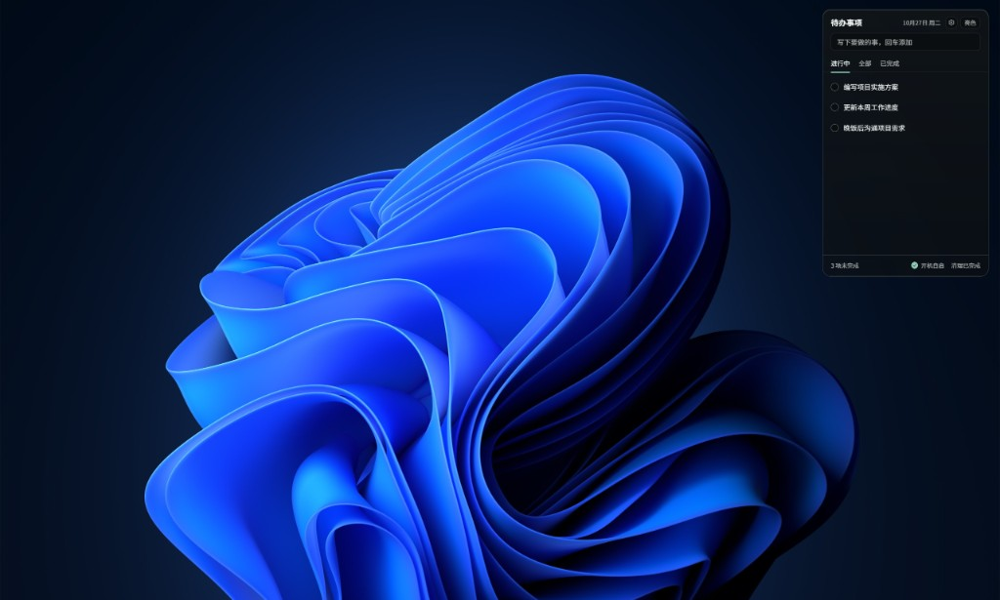
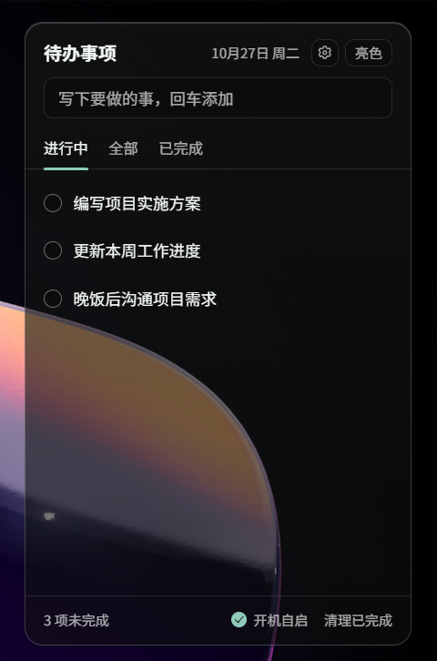
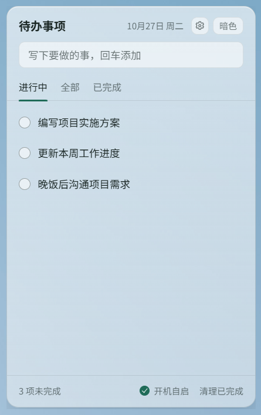
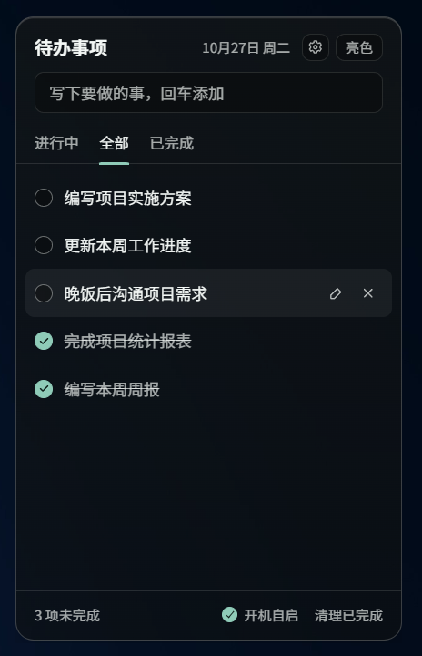
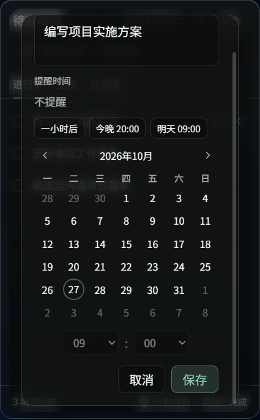

# Desktop Todo

Windows 桌面悬浮待办，基于 Tauri 2 与 Vue 3。窗口无边框、透明、不进任务栏，默认停在其他窗口下面，可从托盘置顶。

## 界面

窗口默认贴在桌面右上角：



暗色与亮色：

| 暗色 | 亮色 |
| --- | --- |
|  |  |

全部列表里可以完成、编辑和删除；编辑时可以设置提醒时间：

| 全部 | 提醒 |
| --- | --- |
|  |  |

## 功能

- 添加、编辑、删除、完成待办，并按进行中、全部、已完成筛选
- 为事项设置提醒时间，到期后发送系统通知
- 待办保存在本地 `todos.json`，可在设置里更换数据目录
- 亮色 / 暗色主题，选择记在本机
- 开机自启，可在窗口底部开关
- 系统托盘：显示 / 隐藏、置顶、退出
- 按 Win+D 显示桌面时，待办仍留在桌面上；切回其他应用后，重新回到窗口下层

## 环境

- Windows
- [Node.js](https://nodejs.org/)
- [Rust](https://rustup.rs/) 与 MSVC 构建工具

## 开发

```bash
npm install
npm run tauri:dev
```

前端开发服务器在 `http://localhost:1420`，由 `tauri dev` 自动启动。

## 打包

```bash
npm run tauri:build
```

安装包输出到 `src-tauri/target/release/bundle/`。

## 数据

默认目录是 `%APPDATA%\Desktop Todo Tauri`：

| 文件 | 作用 |
| --- | --- |
| `todos.json` | 待办列表，可随数据目录一起迁移 |
| `settings.json` | 自定义数据目录，始终留在默认目录 |

在窗口右上角的设置里选择新文件夹时：目标文件夹没有 `todos.json`，会把现有文件移过去；已经有这份文件，则改用那份数据。
