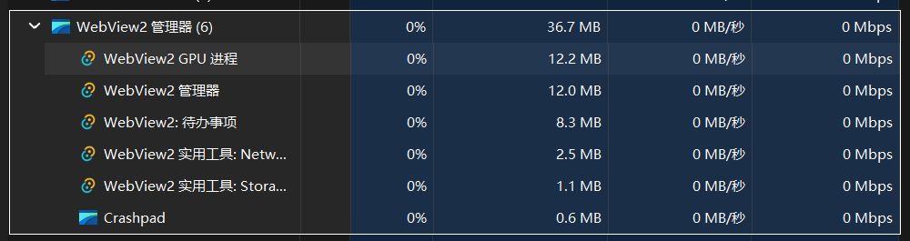

# Desktop Todo

English · [中文](README.zh-CN.md)

A floating Windows desktop todo list, built with Tauri 2 and Vue 3. The window is borderless and transparent, stays off the taskbar, sits beneath other windows by default, and can be pinned from the tray.

## Interface

The window sits at the top-right of the desktop by default:


Dark and light:

| Dark | Light |
| --- | --- |
|  |  |

The full list can complete, edit, and delete items. Editing can set a reminder:

| All | Reminder |
| --- | --- |
|  |  |

## Features

- Add, edit, delete, and complete todos, and filter by active, all, and done
- Set a reminder time; a system notification is sent when it is due
- Todos are stored locally in `todos.json`, and the data directory can be changed in Settings
- Light and dark themes; the choice is saved on this machine
- Launch at startup, toggled at the bottom of the window
- System tray: show / hide, pin on top, quit
- After Win+D shows the desktop, the todo stays on the desktop; when you return to other apps, it drops back beneath them

## Memory

Tauri's native layer is written in Rust. That Rust code compiles to a native program and does not ship a separate JavaScript runtime. The interface reuses the system's WebView2, so the resident memory stays low. In Task Manager, the processes for this app total about **36.7 MB**, of which the todo window itself is about **8.3 MB**:



## Requirements

- Windows
- [Node.js](https://nodejs.org/)
- [Rust](https://rustup.rs/) and the MSVC build tools

## Development

```bash
npm install
npm run tauri:dev
```

The frontend dev server is at `http://localhost:1420` and is started by `tauri dev`.

## Build

```bash
npm run tauri:build
```

The installer is written to `src-tauri/target/release/bundle/`.

## Data

The default directory is `%APPDATA%\Desktop Todo Tauri`:

| File | Role |
| --- | --- |
| `todos.json` | The todo list. It moves with the data directory. |
| `settings.json` | The custom data directory. This file always stays in the default directory. |

When a new folder is chosen in the settings at the top-right of the window: if that folder has no `todos.json`, the current file is moved there; if it already has one, the app switches to that copy.
